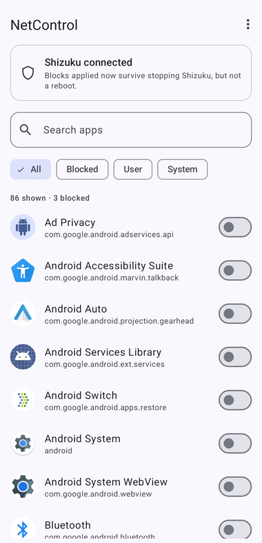
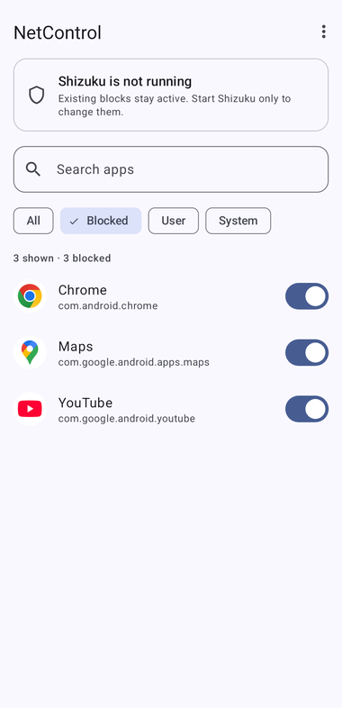
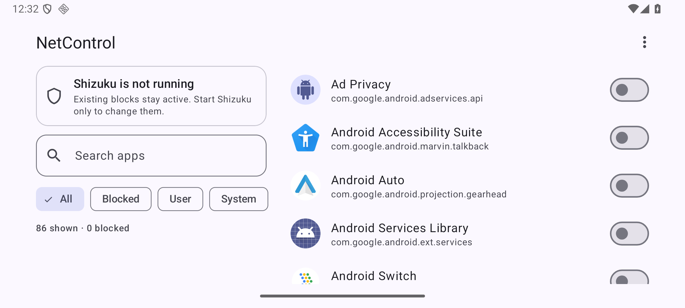

<p align="center">
  
</p>

<h1 align="center">NetControl</h1>

<p align="center">
  Cut any app off <b>WiFi and mobile data</b> on an unrooted phone.<br>
  No VPN, no root, and nothing running in the background.
</p>

<p align="center">
  <a href="../../actions/workflows/build.yml"></a>
  <a href="../../releases/latest"></a>
  <a href="../../releases"></a>
  
</p>

<p align="center">
  <a href="../../releases/latest/download/NetControl.apk">
    
  </a>
</p>

<p align="center">
  <sub>Android 15 or newer. Needs <a href="https://github.com/RikkaApps/Shizuku">Shizuku</a>, but only while you change a block.</sub>
</p>

<p align="center">
  
  
  
</p>

<p align="center">
  
</p>

Android has no built in way to do this. Samsung's *Allowed networks for apps*
lets you disable WiFi **or** mobile data for an app, never both. Every other no
root firewall (NetGuard, Blokada, TrackerControl, RethinkDNS) works by declaring
itself a VPN, which occupies your one and only VPN slot and costs battery.
NetControl does neither.

## ⚙️ How it works

Shizuku lends the app shell (ADB) privileges just long enough to run Android's
own firewall commands:

```
cmd connectivity set-chain3-enabled true
cmd connectivity set-package-networking-enabled false <package>
```

That sets the app's deny bit in `FIREWALL_CHAIN_OEM_DENY_3`, a kernel BPF
firewall map owned by `netd`. The block is enforced below the app layer, so it
covers WiFi and cellular identically and costs no battery.

**The rule lives in the kernel, not in NetControl and not in Shizuku.** Shizuku
is only the delivery mechanism; once a command has run, nothing links the rule
back to it. That has one very useful consequence:

> ### Shizuku does not need to keep running
> You only need it at the moment you change a block. Apply your blocks, then
> force stop Shizuku and turn Wireless debugging back off. The blocks stay
> active with nothing running in the background.

A reboot clears the map. That is the one unavoidable cost of not using a VPN or
root, and NetControl re-applies your blocks automatically the next time you open
it with Shizuku available.

## ✅ Requirements

**Android 15 or newer.** These `cmd connectivity` subcommands were added in
Android 15. They do not exist on Android 14, where every toggle fails.
See [Verified behaviour](#verified-behaviour).

## ⬇️ Download

[**Download NetControl.apk**](../../releases/latest/download/NetControl.apk),
or browse every build on the [Releases page](../../releases).

Every release ships two builds. They are identical apps; they differ only in
whether the app can reach a network to update itself.

| Build | Network permission | Updates by |
|---|---|---|
| [`NetControl.apk`](../../releases/latest/download/NetControl.apk) | `INTERNET`, used only when you tap Check for updates | Itself, or Obtainium |
| [`NetControl-foss.apk`](../../releases/latest/download/NetControl-foss.apk) | **none at all** | F-Droid client, or Obtainium |

**If you want to be able to prove the app cannot phone home, take the foss
build.** It declares no `INTERNET` permission, so you can confirm from the
manifest, or from Android's own App info screen, that it cannot reach a network.
That is worth something in a tool whose job is blocking network access. CI fails
the build if that ever stops being true.

The standard build adds `INTERNET` so it can offer updates. It only ever checks
when you tap **Menu, Check for updates**: there is no check on launch, no
background check and no scheduled job. It talks to `api.github.com` and nothing
else, and asks before downloading and again before installing.

Either way, [Obtainium](https://github.com/ImranR98/Obtainium) can watch this
repository and install new versions for you, which is the least work and needs
no permission inside NetControl at all.

> **One last uninstall.** Builds up to v1.6 were signed with a throwaway debug
> key that changed on every CI run, so none of them can be updated in place.
> Uninstall NetControl once before installing v2.x. After that, updates install
> over the top and your saved blocks survive.

## 🔧 One time setup

1. Install **Shizuku** (Play Store, or [RikkaApps/Shizuku](https://github.com/RikkaApps/Shizuku)).
2. Settings, About phone, Software information, tap **Build number** 7 times.
3. Settings, Developer options, turn on **Wireless debugging**.
4. Open Shizuku, **Start via Wireless debugging**, follow the pairing steps.
5. Open NetControl and tap **Allow** on the permission card.

## 📱 Daily use

Flip the switch next to any app. The line under its name reports the **real
kernel state**, read straight back after every write:

| | |
|---|---|
| *Blocked, enforced by the kernel* | the rule is live |
| *Command ran but the rule did not stick* | the write was rejected, so the app is **not** blocked |
| *Could not read state: ...* | the command failed, and the raw error is shown |

The header counts anything that is **NOT enforced**, so a silent failure cannot
hide. **Menu, Verify blocks** re-reads every saved block without changing
anything.

Once you are done, stop Shizuku. Your blocks remain.

## 🔄 After a reboot

Start Shizuku (step 4, no re-pairing needed) and open NetControl. Saved blocks
are re-applied automatically on launch. Then stop Shizuku again.

**Menu, Re-apply blocks** does the same thing manually if you need it.

<a id="verified-behaviour"></a>

## 🧪 Verified behaviour

Tested end to end on an Android 16 emulator (API 36), with Shizuku started over
ADB so it ran at the same shell UID it uses on a real phone. Command
availability was also checked on Android 14 and 15:

| Check | Result |
|---|---|
| Commands exist and run at shell UID (not root) | yes on Android 15 and 16, **no on Android 14** |
| Blocking a package sets its deny bit | `com.android.chrome:deny`, `chain:enabled` |
| A blocked browser actually loses network | `ERR_NAME_NOT_RESOLVED`, while the device itself still pings |
| Blocks survive killing the Shizuku server | yes, still `:deny` with no Shizuku process alive |
| Blocks survive a reboot | no, `chain:disabled` and every package back to `:allow` |
| Opening the app after a reboot restores them | yes, automatically, with no button press |

The one thing an emulator cannot answer is whether a specific OEM also uses
`FIREWALL_CHAIN_OEM_DENY_3` for its own features and overwrites these rules. If
blocks turn red after a system settings change, that is the likely cause.

## ⚠️ Limitations

- Blocks are cleared by a reboot, then re-applied when you next open the app.
- Requires Android 15. Android 14 and older lack the commands entirely.
- Reinstalling a blocked app changes its UID, so re-apply after that.
- No per network rules. The kernel chain this uses is one bit per app, not one
  per transport, so blocking on cellular but allowing on WiFi is not possible.

## 🚧 Planned

Ideas, not promises. Each one has to fit the rules in
[CONTRIBUTING.md](CONTRIBUTING.md#design-rules): no VPN slot, nothing running in
the background, no network access.

- **Export and import the block list.** A reinstall changes an app's UID and a
  new phone starts empty, so a plain text file of package names would save
  re-ticking everything by hand.
- **Bulk actions.** Block everything matching the current search or filter.
  First time setup is currently one tap per app.
- **A way to notice a reboot cleared your blocks** without having to remember to
  open the app. A Quick Settings tile is the obvious shape, though a tile is
  technically a service, so it needs thought before it earns a place.

Interested in one of these? Say so in an [issue](../../issues) before you start.

## 🤝 Contributing

Pull requests, bug reports and feedback are welcome. See
**[CONTRIBUTING.md](CONTRIBUTING.md)** for how to build and run the project, how
layout changes are checked across screen sizes, and the design rules the app is
built around.

The most useful contribution is not code. NetControl depends on `cmd
connectivity` behaviour that varies by Android version and OEM skin, and no
emulator can tell us how your phone behaves. If you have confirmed it works, or
found that it does not, please [file a device report](../../issues/new). Even a
one line "works as documented on <model>, Android <version>" genuinely helps.

## 🔨 Build

CI builds a signed APK on every push and attaches it to a
[Release](../../releases). Locally you need **JDK 17** (JDK 21 also works, newer
does not) and an Android SDK with platform 34:

```bash
./gradlew assembleDebug
```

Releases are signed with a stable key held in GitHub secrets, so each one
installs over the last without losing your blocks.
