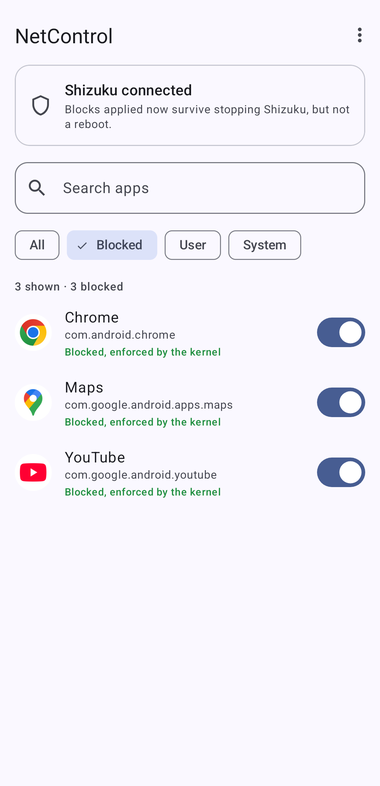
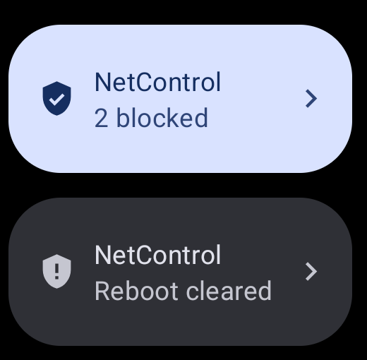

  

<h1 align="center">NetControl</h1>

  Cut any app off <b>WiFi and mobile data</b> on an unrooted phone. 
  No VPN, no root, and nothing running in the background.

  
  
  
  

  

  Android 15 or newer. Needs <a href="https://github.com/RikkaApps/Shizuku">Shizuku</a>, but only while you change a block.

  
  
  

  

Android has no built in way to do this. Where a manufacturer ships a per app
network setting at all, it lets you turn off WiFi **or** mobile data for an app,
never both. Every other no root firewall (NetGuard, Blokada, TrackerControl,
RethinkDNS) works by declaring itself a VPN, which occupies your one and only
VPN slot and costs battery. NetControl does neither.

## ⬇️ Install

[**Download NetControl.apk**](../../releases/latest/download/NetControl.apk),
or browse every build on the [Releases page](../../releases).

[Obtainium](https://github.com/ImranR98/Obtainium) can watch this repository and
install new versions for you. The app can also update itself from **Menu, Check
for updates**, which is the only thing it ever uses the network for: no check on
launch, no background check, no scheduled job. It talks to `api.github.com` and
nothing else, and asks before downloading and again before installing.

> **One last uninstall.** Builds up to v1.6 were signed with a throwaway debug
> key, so they cannot be updated in place. Uninstall NetControl once before
> installing v2.x. After that your saved blocks survive every update.

## 🔧 One time setup

1. Install **Shizuku** (Play Store, or [RikkaApps/Shizuku](https://github.com/RikkaApps/Shizuku)).
2. Settings, About phone, Software information, tap **Build number** 7 times.
3. Settings, Developer options, turn on **Wireless debugging**.
4. Open Shizuku, **Start via Wireless debugging**, follow the pairing steps.
5. Open NetControl and tap **Allow** on the permission card.

## 📱 Daily use

Flip the switch next to any app. The line under its name is the **real kernel
state**, read straight back after every write, so a rule that did not stick
says so rather than showing a green switch and lying to you. The header counts
anything that is **NOT enforced**, and **Menu, Verify blocks** re-reads every
saved block without changing anything.

## 🔄 After a reboot

A reboot empties the kernel map, so saved blocks need writing again. Start
Shizuku (step 4, no re-pairing needed) and open NetControl: your blocks are
re-applied automatically on launch. Then stop Shizuku again.

To be told rather than having to remember, add the **NetControl** tile to your
Quick Settings panel.

  

It reads *N blocked* while every saved block is live in the kernel, *Reboot
cleared* once a restart has wiped them, and *Not enforced* if a block did not
stick. The reboot is worked out from the clock, so the tile needs neither
Shizuku nor anything running in the background, and Android binds it only while
the shade is open. It reports, it does not fix: tapping it opens the app, which
does the re-applying.

## ⚠️ Limitations

- Blocks are cleared by a reboot, then re-applied when you next open the app.
- Requires Android 15. Android 14 and older lack the commands entirely.
- Reinstalling a blocked app changes its UID, so re-apply after that.
- No per network rules. The kernel chain this uses is one bit per app, not one
  per transport, so blocking on cellular but allowing on WiFi is not possible.
- An OEM that uses `FIREWALL_CHAIN_OEM_DENY_3` for its own features can
  overwrite these rules. Blocks turning red after a system settings change is
  the sign.

## 🚧 Planned

Ideas, not promises. Each has to fit the [design
rules](CONTRIBUTING.md#design-rules): no VPN slot, nothing in the background.

- **Export and import the block list**, so a reinstall or a new phone does not
  mean re-ticking everything by hand.
- **Bulk actions**, to block everything matching the current search or filter.

Interested in one? Say so in an [issue](../../issues) before you start.

## 🤝 Contributing

Pull requests, bug reports and feedback are welcome. See
**[CONTRIBUTING.md](CONTRIBUTING.md)** for how to build and run the project and
the design rules the app is built around.

The most useful contribution is not code. NetControl depends on `cmd
connectivity` behaviour that varies by Android version and OEM skin, and no
emulator can tell us how your phone behaves. If it works, or if it does not,
please [file a device report](../../issues/new). Even a one line "works as
documented on <model>, Android <version>" genuinely helps.

<h3 align="center">
  If you like this project, please <a href="../../stargazers">star it</a> 🌟
</h3>
